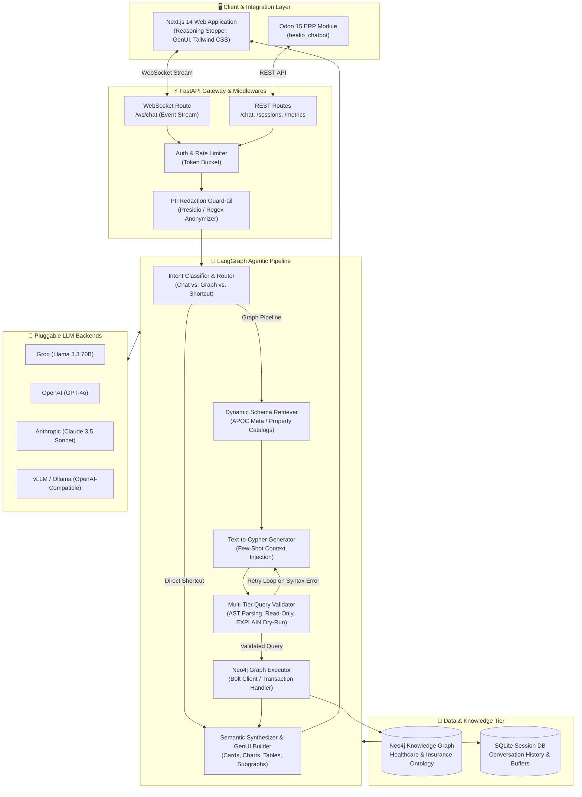

# Healio AI — Enterprise GraphRAG & Generative UI Platform

<p align="center">
  
</p>

<p align="center">
  <strong>Agentic GraphRAG & Generative UI Assistant for Healthcare & Health Insurance Intelligence</strong>
</p>

<p align="center">
  
  
  
  
  
  
  
  
</p>

---

## 📌 Overview

**Healio AI** is an enterprise-grade **Graph Retrieval-Augmented Generation (GraphRAG)** conversational system engineered as a **Graduation Project (Projet de Fin d'Études - PFE)**.

Healthcare and health insurance data is inherently relational: affiliates, insurance policies, healthcare providers, care bulletins (*bulletins de soins*), medical acts, and reimbursement ceilings form a dense, heterogeneous web of constraints. Traditional vector-only RAG approaches struggle with multi-hop relations, aggregations, and strict business logic rules.

**Healio AI solves this challenge by:**
1. Transforming natural-language business questions into **validated Cypher queries** executed against a **Neo4j Knowledge Graph**.
2. Providing a **Multi-Step Agentic Reasoning Loop** orchestrated with **LangGraph** (intent routing, dynamic ontology extraction, AST validation, execution, and semantic synthesis).
3. Delivering a state-of-the-art **Generative UI (GenUI)** interface in **Next.js 14** featuring real-time reasoning stepper visualization, interactive graphs, data tables, and financial charts.
4. Enabling seamless enterprise workflow integration via a dedicated **Odoo 15 ERP module**.

---

## 🏛️ System Architecture



---

## ✨ Key Features

### 1. 🔍 Autonomous Agentic GraphRAG Pipeline
- **Dynamic Schema Retrieval**: Automatically introspects the Neo4j schema (labels, relationships, property data types) and dynamically injects only relevant sub-ontologies into the LLM context.
- **Self-Correcting Validation Loop**: Generated Cypher undergoes static AST checking, security keyword blacklisting (`DELETE`, `MERGE`, `DROP`, `CREATE`), and an `EXPLAIN` dry-run against Neo4j before execution. If validation fails, error feedback is passed back to the generator for automated correction.
- **High-Speed Deterministic Shortcuts**: Direct pattern resolver for recurring operations (e.g., `\adherent <id>`, `\help`) operating at sub-millisecond speeds.

### 2. 🎨 Next-Generation Generative UI (GenUI)
- **Live Reasoning Stepper**: Displays internal agent steps in real-time with timing metrics:
  - *Analysis & Intent Classification*
  - *Ontology & Schema Extraction*
  - *Cypher Query Generation & Inspection*
  - *Syntax & Safety Validation*
  - *Graph Cluster Execution & GenUI Assembly*
- **Dynamic Multi-Modal Blocks**: The assistant renders customized widgets according to response nature:
  - 📇 **Affiliate & Policy Cards**: Summary of policy terms, coverage ceilings, and active status.
  - 📊 **Interactive Analytics**: Dynamic bar charts and donut breakdown of healthcare expenditures by medical discipline.
  - 📋 **Claims Data Tables**: Detailed breakdown of medical care bulletins with validation states.
  - 🕸️ **Interactive Subgraph Visualizer**: Node-link graph component exploring relationship topologies directly in the browser.

### 3. 🛡️ Enterprise-Grade Security & Guardrails
- **PII Redaction**: Pre-flight detection and masking of personally identifiable information (patient names, identity numbers).
- **Read-Only Enforcer**: Strict database security guarantees ensuring analytical queries cannot mutate state.
- **Audit Logging & Tracing**: Distributed tracing with **Langfuse** and local audit logs.
- **Rate Limiting**: Configurable token bucket algorithm safeguarding APIs from abuse.

### 4. 💼 ERP Integration (Odoo 15)
- Native Odoo addon (`healio_chatbot`) providing an embedded chat interface inside the business management interface for claims managers and underwriters.

---

## 📁 Repository Structure

```
STAGEE/
├── agent/                  # LangGraph core workflow
│   ├── nodes/              # Pipeline nodes (Intent, Schema, Cypher, Validation, GenUI)
│   ├── edges.py            # Graph routing logic & conditional edges
│   ├── graph.py            # LangGraph compiled StateGraph & runners
│   └── state.py            # AgentState schema & typed annotations
├── api/                    # FastAPI web application
│   ├── middleware/         # Auth, Rate Limiting, PII sanitization
│   ├── routers/            # WebSocket (/ws/chat) & HTTP endpoints
│   ├── schemas/            # Pydantic request/response schemas
│   └── database.py         # SQLAlchemy engine & session factory
├── config/                 # Application settings & environment loader
│   └── settings.py         # Strongly-typed Pydantic settings
├── frontend/               # Next.js 14 Modern Web UI
│   ├── app/                # App router (layout, globals.css, page)
│   ├── components/         # React components
│   │   ├── chat/           # ChatWindow, Input, Stepper, Message
│   │   ├── genui/          # GenUI dynamic blocks (Cards, Tables, Charts, Graphs)
│   │   ├── background/     # Mesh wave & particle field animations
│   │   └── layout/         # Header & Sidebar navigation
│   └── public/             # Static brand assets
├── graph/                  # Neo4j Database Interaction
│   ├── schema/             # Schema manager, topology, property & value catalogs
│   ├── validators/         # AST parser, dry runner, syntax validator
│   ├── client.py           # Neo4j Bolt driver lifecycle
│   ├── executor.py         # Read query runner & error handling
│   └── mcp_client.py       # Model Context Protocol (MCP) client
├── guardrails/             # PII detector & query security filters
├── llm/                    # Pluggable LLM provider abstraction
│   ├── prompts/            # System instructions & few-shot catalogs
│   ├── providers/          # Groq, OpenAI, Anthropic, OpenAI-compatible
│   └── router.py           # Multi-provider runtime router
├── memory/                 # Session manager & conversation buffer
├── models/                 # SQLAlchemy ORM models (sessions, messages)
├── observability/          # Langfuse tracing & Prometheus metrics
├── odoo_module/            # Odoo 15 ERP Module
│   └── healio_chatbot/     # Manifest, controllers, views, assets
├── repository/             # Session & message persistence repositories
├── main.py                 # Interactive CLI & one-shot CLI entrypoint
├── pyproject.toml          # Python package specification
└── README.md               # Project documentation
```

---

## 🚀 Getting Started

### Prerequisites

- **Python**: version `3.11+`
- **Node.js**: version `18.x` or `20.x`
- **Neo4j**: version `5.x` (Local Neo4j Desktop, Docker, or Neo4j AuraDB)

---

### 1. Backend Setup

1. **Clone the repository:**
   ```bash
   git clone https://github.com/your-username/healio-ai.git
   cd healio-ai
   ```

2. **Create and activate a virtual environment:**
   ```powershell
   # Windows (PowerShell)
   python -m venv venv
   .\venv\Scripts\activate

   # Linux / macOS
   python3 -m venv venv
   source venv/bin/activate
   ```

3. **Install dependencies in editable mode:**
   ```bash
   pip install -e .
   ```

4. **Configure environment variables:**
   ```bash
   copy .env.example .env
   ```
   Open `.env` and fill in your connection details:
   ```env
   # Neo4j Database
   NEO4J_URI=neo4j+s://your-instance.databases.neo4j.io
   NEO4J_USERNAME=neo4j
   NEO4J_PASSWORD=your-secure-password

   # LLM Provider (groq | openai | anthropic | openai_compatible)
   LLM_PROVIDER=groq
   GROQ_API_KEY=gsk_your_groq_api_key
   GROQ_MODEL=llama-3.3-70b-versatile

   # Optional Observability
   LANGFUSE_TRACING_ENABLED=false
   ```

5. **Start the FastAPI backend server:**
   ```bash
   uvicorn api.main:app --reload --port 8000
   ```
   - API Docs (Swagger): `http://127.0.0.1:8000/docs`
   - WebSocket Endpoint: `ws://127.0.0.1:8000/ws/chat`

---

### 2. Frontend Setup

1. **Navigate to the frontend directory:**
   ```bash
   cd frontend
   ```

2. **Install Node packages:**
   ```bash
   npm install
   ```

3. **Configure frontend environment:**
   ```bash
   copy .env.example .env.local
   ```
   Verify `frontend/.env.local`:
   ```env
   NEXT_PUBLIC_API_BASE_URL=http://127.0.0.1:8000
   NEXT_PUBLIC_WS_URL=ws://127.0.0.1:8000
   ```

4. **Run the Next.js development server:**
   ```bash
   npm run dev
   ```
   Open [http://localhost:3000](http://localhost:3000) in your browser.

---

### 3. CLI Mode

You can also test queries directly from your terminal:

```bash
# Single question query
python main.py "Quels sont les actes médicaux les plus prescrits ?"

# Interactive conversational session
python main.py
```

---

## 📡 API & WebSocket Protocol

### WebSocket Event Stream (`/ws/chat`)

The frontend connects via WebSocket to receive granular execution events:

| Event Type | Payload Attributes | Description |
|---|---|---|
| `start` | `trace_id`, `question`, `session_id` | Initial connection confirmation |
| `step_start` | `step_index`, `node`, `label`, `detail` | Reasoning stepper starts a new phase |
| `step_complete`| `step_index` | Reasoning step completed |
| `cypher` | `cypher` | Inspectable Cypher query generated by the agent |
| `token` | `token` | Incremental streaming of LLM answer |
| `final` | `answer`, `cypher`, `results`, `genui_blocks`, `trace` | Completed answer with structured GenUI blocks |
| `error` | `error` | Graceful error notification |

---

## 🛡️ Security & Privacy Guardrails

- **Zero-Mutation Enforcement**: The AST parser rejects queries containing mutation keywords (`DELETE`, `SET`, `REMOVE`, `MERGE`, `CREATE`, `DROP`).
- **Dry-Run Query Plans**: High-cost query prevention via Neo4j `EXPLAIN` validation.
- **Data Protection**: Personal Identifiable Information (PII) is masked before prompt dispatch.
- **Isolated Sessions**: Conversation contexts are segregated per session in SQLite with automatic TTL expiration.

---

## 🎓 Academic & Engineering Context

This project was conceived as an advanced **PFE (Projet de Fin d'Études)** addressing high-complexity challenges at the intersection of:
- **Knowledge Representation**: Ontological modeling of healthcare reimbursement structures in graph databases.
- **Agentic AI & GraphRAG**: Multi-agent graph traversal overcoming the limitations of vector-only RAG.
- **Enterprise Human-AI Interaction**: Generative UI and transparent step-by-step reasoning stepper for user explainability and trust.

---

## 📄 License

This project is licensed under the **MIT License** — see the [LICENSE](LICENSE) file for details.
